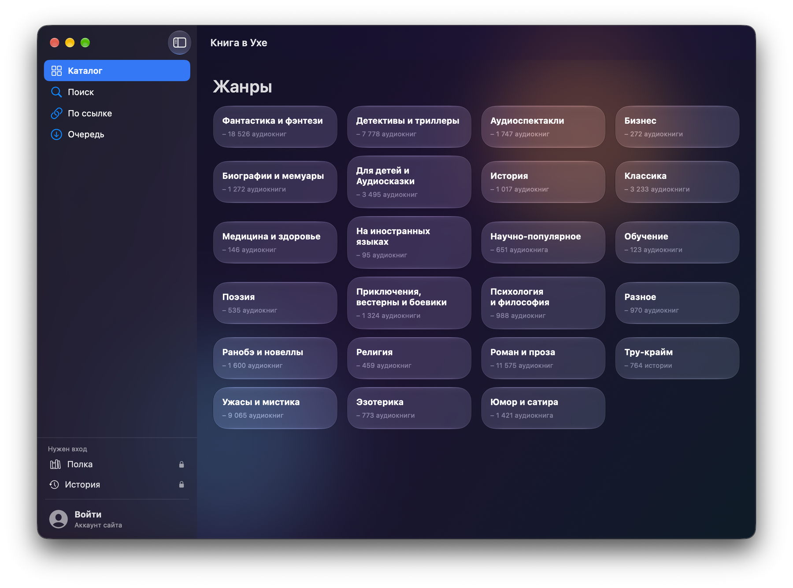
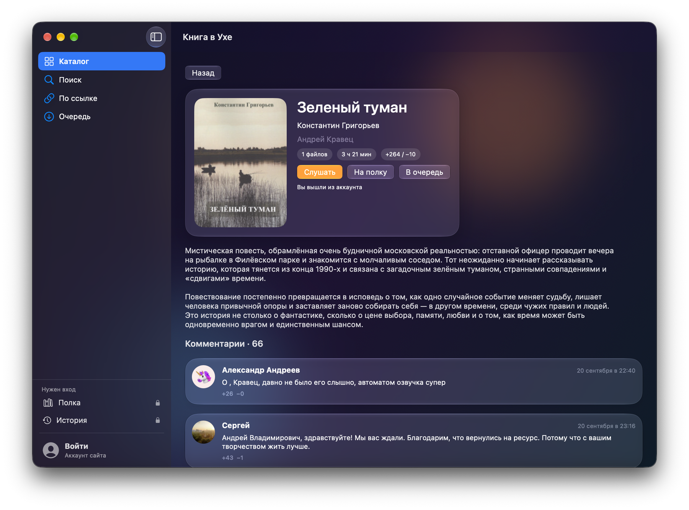
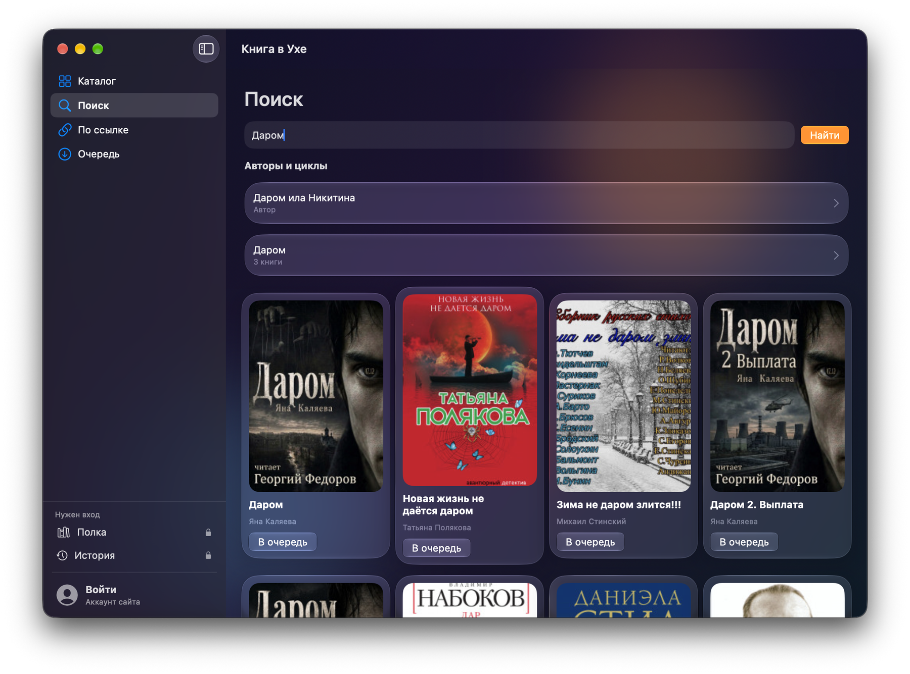
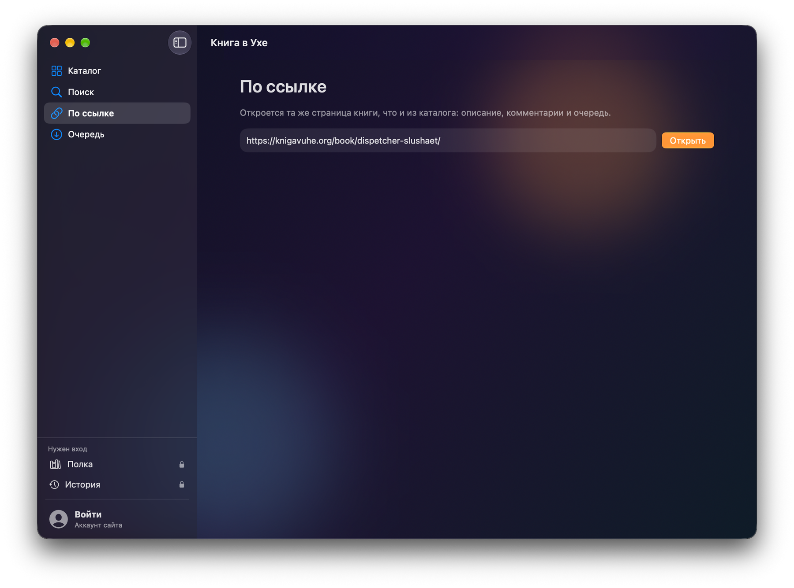

# Книга в Ухе

Программа для Mac, в которой слушают аудиокниги с knigavuhe.org и сохраняют их на компьютер.

В каталоге книги разложены по жанрам. Можно искать по названию, автору и циклам или вставить ссылку на книгу. Слушать можно сразу, не дожидаясь полной загрузки: программа запоминает место и скорость. Пока одна книга качается, следующую можно поставить в очередь. После входа на сайте появляются полка и история прослушиваний.

Страница программы: [cyprus-team.com/knigavuhe](https://cyprus-team.com/knigavuhe)

Сайт студии: [cyprus-team.com](https://cyprus-team.com/)

Текущая версия: [1.0.0](https://github.com/cyprus-team/knigavuhe/releases/tag/v1.0.0) · [Knigavuhe.dmg](https://github.com/cyprus-team/knigavuhe/releases/download/v1.0.0/Knigavuhe.dmg)

Файл подписан Apple и открывается как обычная программа. Нужна macOS 26, сборка одна для Apple silicon и Intel.

## Снимки

